<p align="center">
  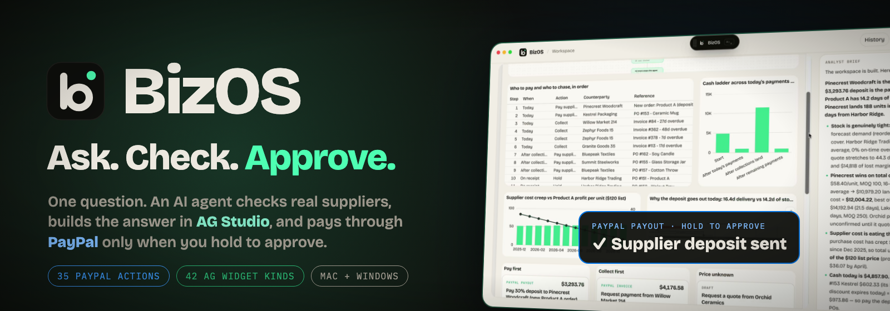
</p>

<div align="center">

<h1>BizOS</h1>

**One question. An AI agent checks real suppliers, builds the answer in AG Studio, and pays through PayPal when you approve.**

*Monday used to take all day. Now it takes one question.*

<p>
  
  
  
</p>
<p>
  
  
  
  
  
  
  
  
  
</p>

<a href="submission/bizos-demo-2m58.mp4"><b>▶ Watch the 2:58 film</b></a> ·
<a href="submission/submission-description.md">Submission</a> ·
<a href="#-the-bizos-loop">The loop</a> ·
<a href="#-ag-studio-taken-to-the-next-level">AG Studio</a> ·
<a href="#-paypal-is-the-money-rail">PayPal</a> ·
<a href="#-run-it">Run it</a> ·
<a href="#truth-boundaries">Truth boundaries</a>

<sub>Press one shortcut over any app → BizOS plans → reads the web, your data and PayPal → builds a live AG Studio workspace → you hold to approve → PayPal acts.</sub>

</div>

<p align="center">
  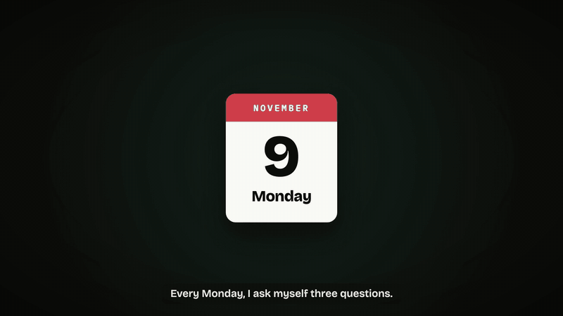
</p>

> [!IMPORTANT]
> Everything in the demo runs for real: real AI agent, real Chrome browsing, real AG Studio workspaces, real PayPal REST calls.
> The marketplace and the company are **sample data**, and PayPal runs in the **Sandbox** (payouts at 10% demo scale so a small sandbox balance lasts).

<details>
<summary><kbd>Contents</kbd></summary>

- [⚡ At a glance](#-at-a-glance)
- [The problem](#the-problem)
- [🔁 The BizOS loop](#-the-bizos-loop)
- [🎬 See it work](#-see-it-work)
- [📊 AG Studio, taken to the next level](#-ag-studio-taken-to-the-next-level)
- [💸 PayPal is the money rail](#-paypal-is-the-money-rail)
- [🧭 Beyond procurement](#-beyond-procurement)
- [📈 Impact](#-impact)
- [🏗️ How it's built](#️-hows-its-built)
- [🖼️ Screenshots](#️-screenshots)
- [🚀 Run it](#-run-it)
- [Truth boundaries](#truth-boundaries)
- [Repository map](#repository-map)

</details>

## ⚡ At a glance

<table>
<tr>
<td width="25%" align="center"><b>01 · ASK</b><br><sub>⌘⇧Space over any app.<br>Type it or say it.</sub></td>
<td width="25%" align="center"><b>02 · CHECK</b><br><sub>The AI plans first, then reads real supplier sites, your data and PayPal.</sub></td>
<td width="25%" align="center"><b>03 · SEE</b><br><sub>The answer arrives as a live AG Studio workspace the AI designed itself.</sub></td>
<td width="25%" align="center"><b>04 · APPROVE</b><br><sub>Hold to approve. Only then does PayPal pay, bill or refund.</sub></td>
</tr>
</table>

## The problem

Every Monday, a small-business owner asks the same three questions:

> **Who should I buy from? Can I afford it? Who still owes me?**

The answers live in three places that don't talk: **supplier websites**, **spreadsheets**, and **PayPal**. It takes twelve tabs and a whole morning. And it's not one shop's problem:

<p align="center">
  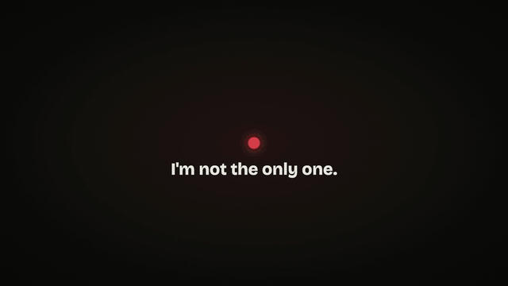
</p>

<p align="center"><sub>36.2M US small businesses (SBA 2026) × 56% owed money × $17,500 average (Intuit QuickBooks 2025) ≈ <b>$355B waiting in unpaid invoices</b>. Our math.</sub></p>

BizOS was born in **procurement**, because that's where stock, suppliers, invoices and cash all meet, and every decision there ends as a payment.

## 🔁 The BizOS loop

| Step | What happens | What can never happen silently |
|---|---|---|
| **Ask** | ⌘⇧Space (Ctrl+Shift+Space on Windows) opens a floating overlay over any app. Type or talk. | Nothing runs yet. |
| **Plan** | The AI planner draws its plan as a graph: what it will read, what waits for what. | Nothing runs until you've seen the plan. |
| **Check** | The agent drives **real Chrome** to read each supplier's own page, queries company data, and reads PayPal (balance, invoices, transactions). | Before any risky click (*Confirm order*), it asks: **Yes, do it / No**. |
| **See** | It designs a live **AG Studio** workspace: AG Grid tables, charts, plan graph, diagrams, and PayPal action cards. | Every number keeps its **source** (web, data, or PayPal). |
| **Approve** | You **hold to approve**. PayPal sends the payout, the invoice, the refund. Due dates go on your calendar. | Money only moves on a human press-and-hold. Each approval is sent **once** and logged. |

## 🎬 See it work

<table>
<tr>
<td width="50%">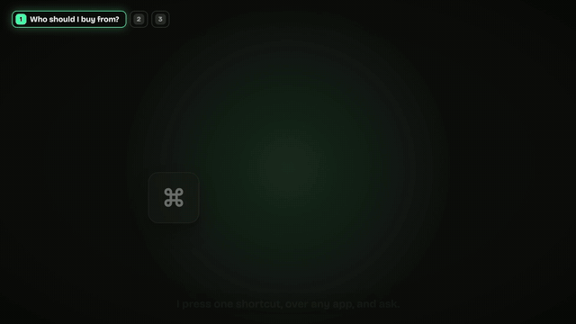<br><sub><b>1 · Ask.</b> One shortcut over any app; the AI writes its plan first.</sub></td>
<td width="50%">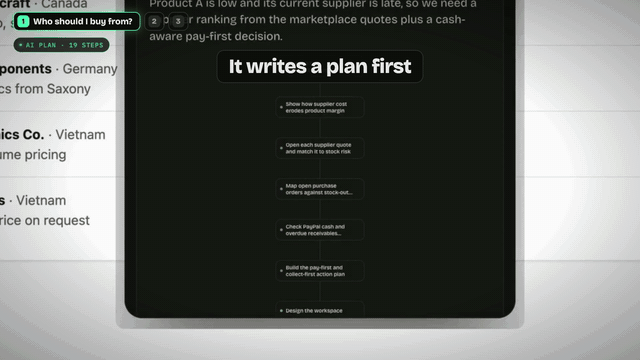<br><sub><b>2 · Agentic commerce.</b> It reads every supplier's real page in Chrome, and asks before it confirms the order.</sub></td>
</tr>
<tr>
<td width="50%">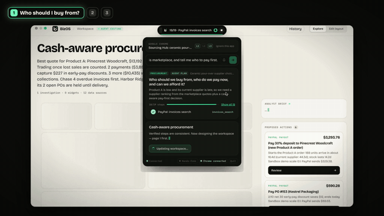<br><sub><b>3 · Built live.</b> The AI designs the AG Studio workspace in front of you, widget by widget.</sub></td>
<td width="50%"><br><sub><b>4 · Can I afford it?</b> Live PayPal balance, minus money already leaving, minus a 10% cushion.</sub></td>
</tr>
<tr>
<td width="50%">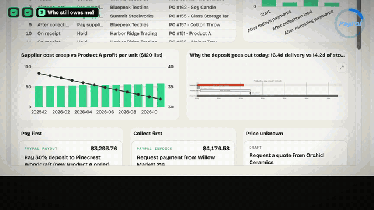<br><sub><b>5 · Hold to approve.</b> PayPal Invoicing bills the late customer; PayPal Payouts pays the supplier.</sub></td>
<td width="50%">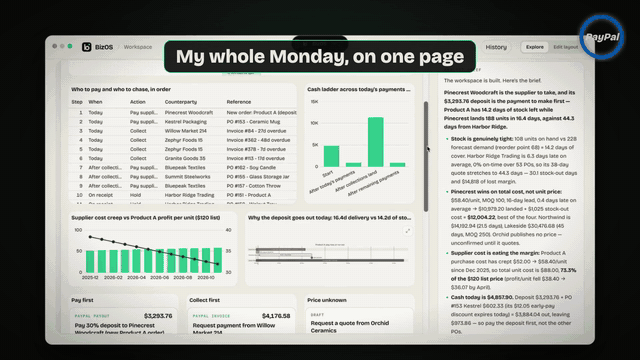<br><sub><b>6 · Done.</b> The whole Monday, on one page.</sub></td>
</tr>
</table>

## 📊 AG Studio, taken to the next level

BizOS doesn't just *show* a grid. **The AI builds an entire AG Studio workspace for every question**, and BizOS **extends AG Studio itself** with its own widgets.

<table>
<tr>
<td width="50%">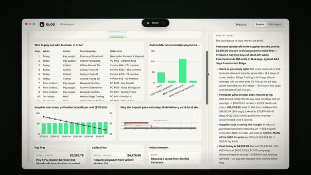<br><sub><b>A whole workspace, not a chart.</b> AG Grid, AG Charts, a combo chart, a gantt diagram, a live plan, PayPal approval cards, all placed by the AI.</sub></td>
<td width="50%">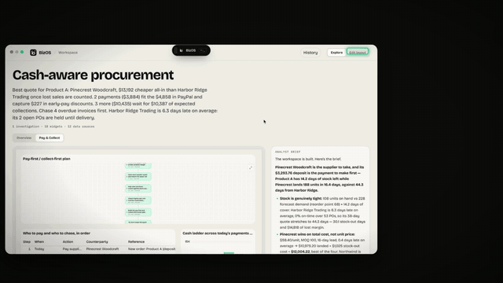<br><sub><b>BizOS widgets inside AG Studio.</b> Plan graph, Diagram, Ideas map, Summary, Text and <b>PayPal action</b> sit in AG Studio's own Compose menu.</sub></td>
</tr>
<tr>
<td width="50%"><br><sub><b>The dashboard asks back.</b> Click an idea on the Ideas map and BizOS starts the next investigation.</sub></td>
<td width="50%"><br><sub><b>Every question gets its own design.</b> Three real runs, three different AI-designed workspaces.</sub></td>
</tr>
</table>

| What BizOS does with AG Studio | How |
|---|---|
| **AI designs the whole canvas** | The compiler picks from **42 widget kinds** (grid, pivot, KPI, 20 chart types, combo, scatter/bubble, treemap, sunburst, gauges, list/date/button filters, text, image), sizes them on a 12-column grid, packs them, names the **pages** and sets a **theme**. |
| **Custom widgets in AG Studio's own menu** | `createWidgets({ additionalTypes })` registers **Plan graph · Diagram · Ideas map · Summary · Text · PayPal action** under a **BizOS** section. Each has an `ai` description so AG Studio's own AI tools know them too. |
| **17 Mermaid diagram types** | Flowchart, gantt, timeline, sequence, mind map, ER, sankey and more, with expand, zoom and pan. |
| **PayPal approvals inside the dashboard** | A PayPal action card is a real AG Studio widget: press and hold to approve, live status on the card. |
| **Ask again, same page** | Follow-up questions edit the **same** workspace live (no remount, no flicker). |
| **You and the AI co-edit safely** | Your *Edit layout* changes are saved; the agent builds on them. A version check stops an older window from erasing newer agent widgets. |
| **Every number has a source** | A *Where the data came from* diagram links each number to Chrome, company data or PayPal. |

## 💸 PayPal is the money rail

<table>
<tr>
<td width="40%" align="center">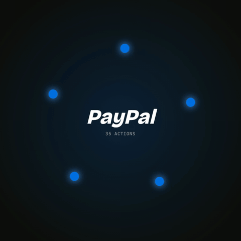</td>
<td width="60%">

**Money in, money out, all through PayPal.**

- **Hold:** Balances, minus payouts still settling, minus a 10% safety cushion
- **Collect:** Invoicing (create, send, remind), Payment Links, Orders + Capture
- **Pay:** Payouts, by press-and-hold
- **Confirm:** payout and invoice status, Transaction Search, webhooks
- **Fix:** Refunds and Disputes, as approval cards

</td>
</tr>
</table>

| Risk level | # | Who acts | PayPal actions |
|---|---|---|---|
| **Read** | 18 | BizOS, automatically | Balances · Transaction Search · Invoices (list, get, search) · Disputes · Payout status · Orders · Captures · Refunds · Catalog products · Billing plans · Subscriptions · Payment links · Webhooks |
| **Act** | 13 | You approve a card | Invoice create / **send** / **remind** / cancel / record payment · Payment link create / update / delete · Product · Order · Plan · Subscription cancel · Dispute message |
| **Money** | 4 | You **press and hold** | **Payouts** · **Refund** · **Order capture** · **Accept dispute claim** |

<table>
<tr>
<td width="50%">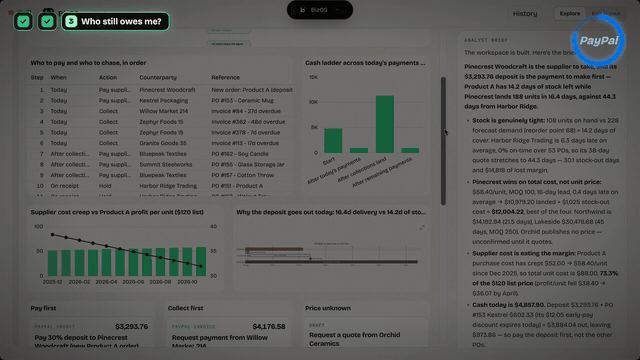<br><sub>Refunds and disputes land in the dashboard as cards, ready to approve.</sub></td>
<td width="50%"><br><sub>35 PayPal actions in 3 risk levels. Card, vault and identity endpoints are not on the list at all.</sub></td>
</tr>
</table>

- **Approving twice never pays twice:** every action carries an idempotency key (`PayPal-Request-Id`, `sender_batch_id`).
- **Every action is audited** with who approved it.
- **Cash gate:** each payout is re-checked against the live balance right before it's sent; a refusal is explained, not hidden.

## 🧭 Beyond procurement

Procurement is the start. The same planner covers **seven verified department flows** (CEO, Finance, Marketing, Engineering, Operations, Procurement, Sales), plus a **general mode** where the agent writes its own queries and designs the workspace from them.

| Ask | What BizOS does |
|---|---|
| *"Find new suppliers for 300 coffee sets"* | Searches the open web, crawls real supplier sites, builds a weighted decision matrix. **No price? It says N/A, and drafts a quote request.** |
| *"Do invoices and payments reconcile?"* | Finance flow: matches PayPal transactions against invoices. |
| *"Which accounts need attention?"* | Sales flow: who is late, who is slipping, what to chase first. |
| *"Which products will stock out?"* | Operations flow: stock cover against demand and open purchase orders. |
| *"Why did cloud spend jump?"* · *"Is this competitor undercutting us?"* | Engineering and CEO flows, same plan → check → workspace loop. |

## 📈 Impact

<p align="center">
  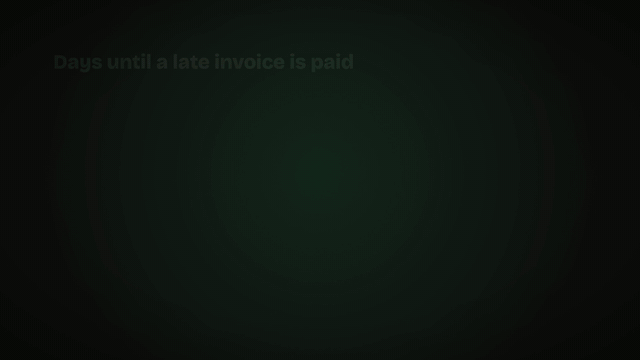
</p>

| Result | Why it holds |
|---|---|
| **A late invoice gets paid ~2 weeks sooner** | Invoices with a PayPal pay button were paid in 16 days vs 32 (Harvest, 250,000+ invoices). BizOS sends exactly that. |
| **0 payments over budget** | The cash gate checks the live PayPal balance before every payout (real code, `actions.py`). |
| **Hours of chasing back every week** | Owners spend ~4 h/week on late invoices and reconciliation (Sage 2025). BizOS turns that into ask → check → approve. |
| **$3.5B paid sooner** | If 1% of the 20.3M owed businesses use a PayPal pay button: 202,760 × $17,500. Our math. |

## 🏗️ How it's built

<p align="center">
  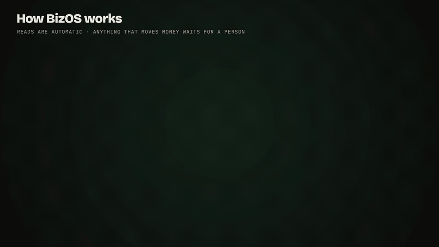
</p>

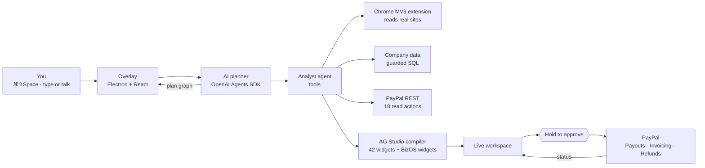

| Layer | Tech | Job |
|---|---|---|
| Desktop | Electron · React · Vite · Motion | Floating overlay pill, workspace window, global shortcut, voice (OS dictation + offline "Hey BizOS" wake word via Vosk) |
| Agents | Python · FastAPI · OpenAI Agents SDK (any OpenAI-compatible model) | Planner agent → user sees plan → analyst agent with tools; streams the brief |
| Browser | Chrome MV3 extension over a local WebSocket bridge | Reads and operates real pages; risky controls always ask first |
| Workspace | **AG Studio 3** (AG Grid + AG Charts) · Mermaid · React Flow | AI-compiled canvas, custom BizOS widgets, live in-place updates |
| Money | **PayPal REST** (Sandbox) | 35 approved actions, 3 risk tiers, idempotent, audited |
| Desktop actions | macOS Accessibility · Windows UI Automation | Calendar (.ics with alarms), app control with confirmations |

## 🖼️ Screenshots

<table>
<tr>
<td width="33%">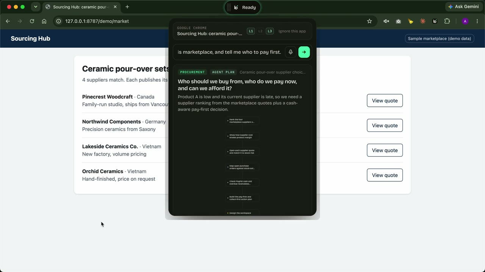<br><sub>The plan comes first</sub></td>
<td width="33%">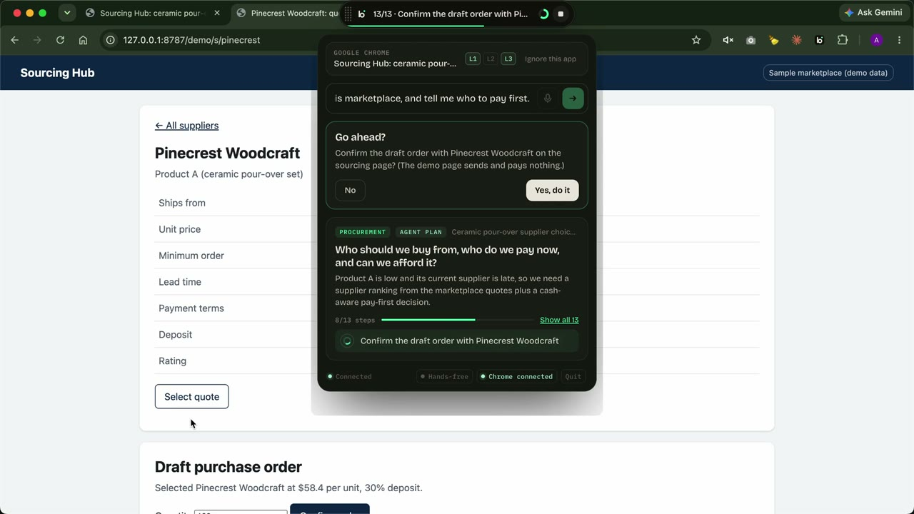<br><sub>Asks before it orders</sub></td>
<td width="33%">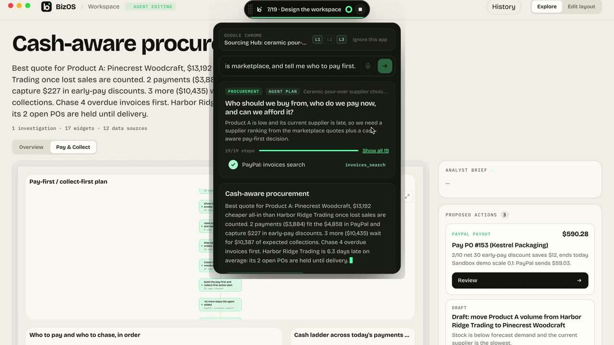<br><sub>Agent editing the workspace live</sub></td>
</tr>
<tr>
<td width="33%">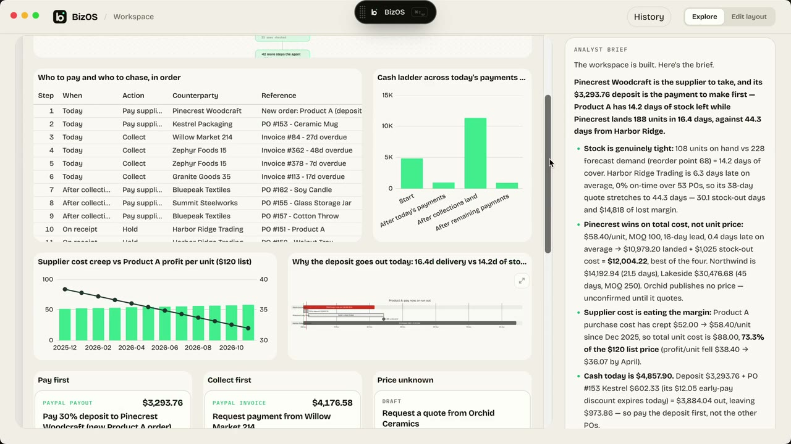<br><sub>AG Grid, charts, gantt and PayPal cards</sub></td>
<td width="33%">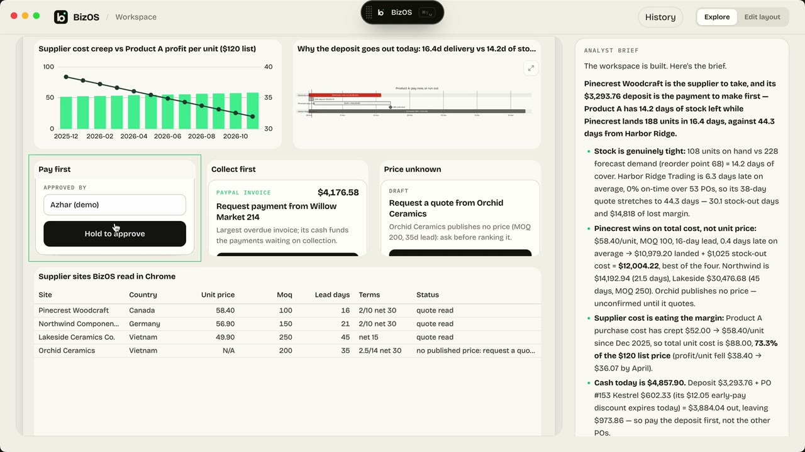<br><sub>Hold to approve</sub></td>
<td width="33%">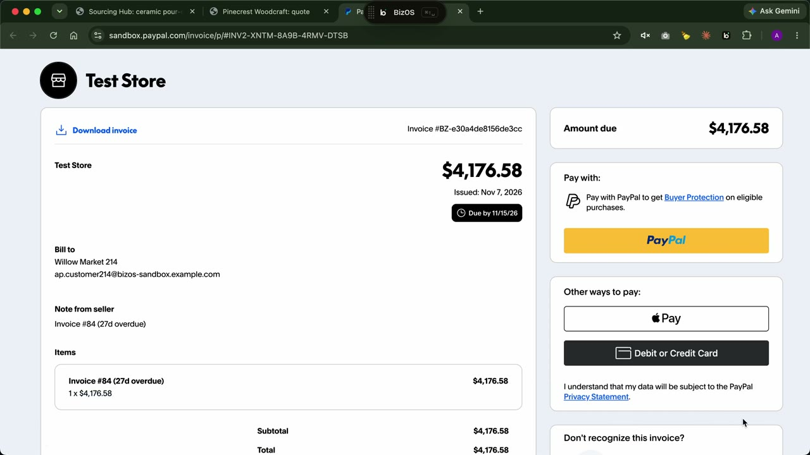<br><sub>The invoice, on PayPal's own page</sub></td>
</tr>
<tr>
<td width="33%">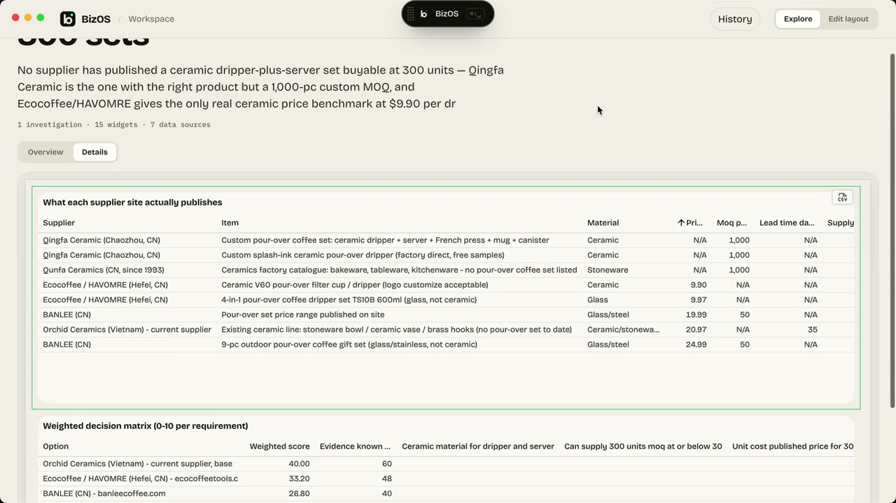<br><sub>Real supplier sites → AG Grid (N/A, never a guess)</sub></td>
<td width="33%">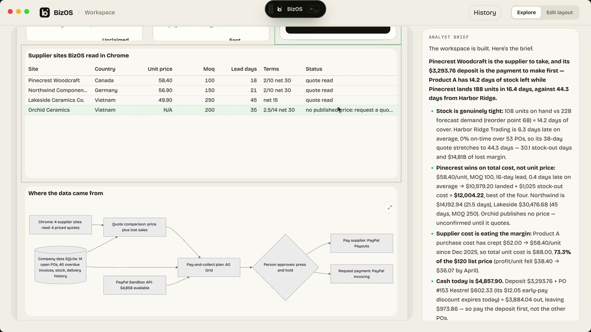<br><sub>Where the data came from</sub></td>
<td width="33%">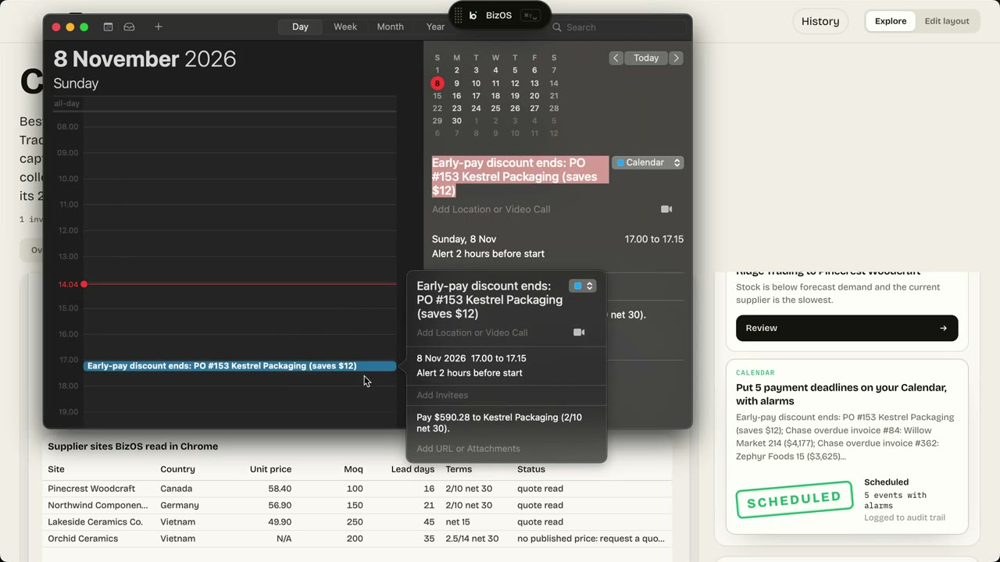<br><sub>Due dates on your calendar</sub></td>
</tr>
</table>

## 🚀 Run it

```bash
# 1. keys: copy into a repo-root .env
#    AGENT_API_KEY, AGENT_BASE_URL, AGENT_MODEL, PAYPAL_CLIENT_ID, PAYPAL_CLIENT_SECRET, AG_STUDIO_LICENSE_KEY
#    (PAYPAL_BASE_URL defaults to the Sandbox; set PAYPAL_SANDBOX_RECEIVER to a sandbox personal account)

# 2. backend + desktop (the desktop app spawns the backend itself)
cd backend && uv sync
cd ../desktop && npm install && npm run dev
```

- **Chrome:** `chrome://extensions` → Developer mode → Load unpacked → `chrome_extension`, then **Pair Chrome** from the overlay footer.
- **PayPal Sandbox app features:** Payouts, Invoicing, Transaction Search, Payment Links & Buttons (optional: Disputes, Subscriptions).
- **Try:** *"Which suppliers should I pay this week, and can I afford it?"* on the sample marketplace (`http://127.0.0.1:8787/demo/market`).
- Full guide: [`TECHNICAL.md`](TECHNICAL.md) · recording guide: [`demo/README.md`](demo/README.md)

### Verify

```bash
cd backend && uv run pytest                                    # 190 passed
cd desktop && npm test && npm run lint && npm run typecheck    # 62 passed
```

## Repository map

| Path | What's inside |
|---|---|
| [`backend/bizos/`](backend/bizos) | Agents, tools, 7 department flows, AG Studio compiler, PayPal client and action catalog |
| [`desktop/`](desktop) | Electron overlay + workspace window, AG Studio host, BizOS widgets |
| [`chrome_extension/`](chrome_extension) | MV3 extension: reads and operates real pages |
| [`demo/`](demo) | Sample marketplace and recording scripts |
| [`submission/`](submission) | Devpost description, film, GIFs, screenshots |

## License

Apache 2.0, see [`LICENSE`](LICENSE). PayPal and AG Grid / AG Studio are trademarks of their owners; this project uses their public developer platforms.
