

  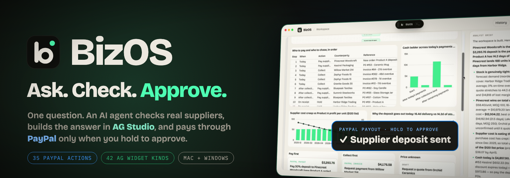

# BizOS

## Ask. Check. Approve. Then PayPal pays.

**Every Monday, a small-business owner asks three questions: *Who should I buy from? Can I afford it? Who still owes me?***
BizOS answers all three from one question. An AI agent checks real suppliers in Chrome, builds the answer as a live **AG Studio** workspace, and moves money through **PayPal** only when you hold to approve.

  
  
  

  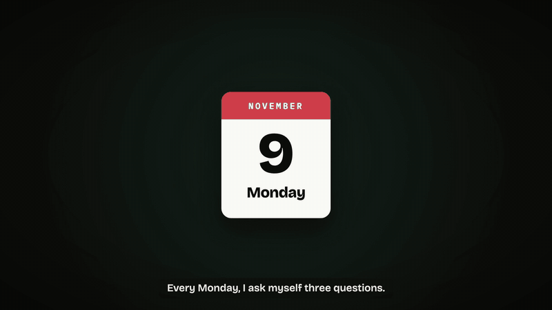

## Inspiration

Small businesses are owed **$355 billion** in unpaid invoices (36.2M US small businesses × 56% owed × $17,500 average, from SBA 2026 and Intuit QuickBooks 2025). Owners lose about **4 hours a week** chasing payments (Sage 2025).

  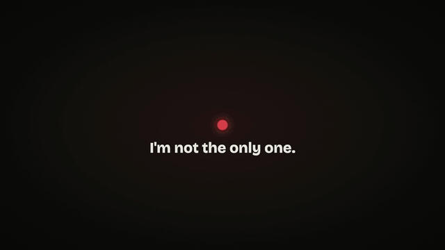

We started with **procurement**, because it's where stock, suppliers, invoices and cash all meet. Every decision there ends as a payment, yet the facts live in three places that don't talk: supplier websites, spreadsheets, and PayPal. We wanted one question to replace twelve tabs, **without ever letting an AI move money on its own.**

  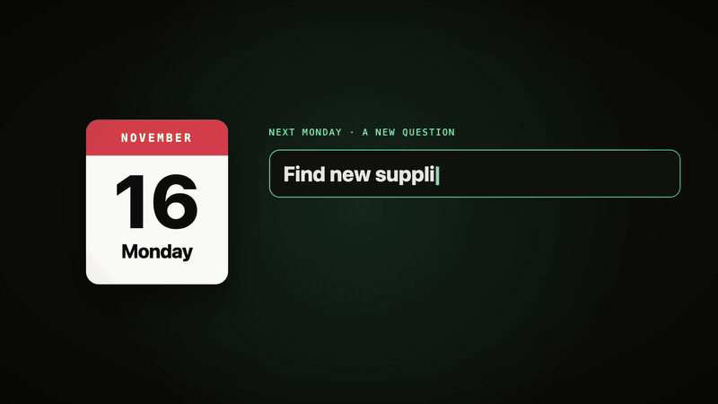 
  <b>One question, four real supplier websites read at once.</b>

## What it does

| | What happens | Why it matters |
|---|---|---|
| **🗣️ Ask** | ⌘⇧Space (Ctrl+Shift+Space) over **any app**. Type or talk. | No new tool to learn; it lives on top of your work. |
| **🧭 Plan** | The AI draws its plan as a graph **before anything runs**. | You see what it will do. |
| **🌐 Check** | It drives **real Chrome**, reads each supplier's own page, queries your data, reads **PayPal**. | Real facts, not guesses. Missing price? It says **N/A** and drafts a quote request. |
| **🛒 Order** | It selects the winner on the supplier's page, then **asks before *Confirm order***. | Agentic commerce with a human checkpoint. |
| **📊 See** | It designs a live **AG Studio** workspace: grids, charts, gantt, plan, PayPal cards. | One page answers the question, and every number shows its source. |
| **✋ Approve** | You **hold to approve**. PayPal invoices the late customer and pays the supplier. Due dates go on your calendar. | Money moves only on a human press, once, logged. |

<table>
<tr>
<td width="50%"> <b>Ask, and see the plan first.</b></td>
<td width="50%">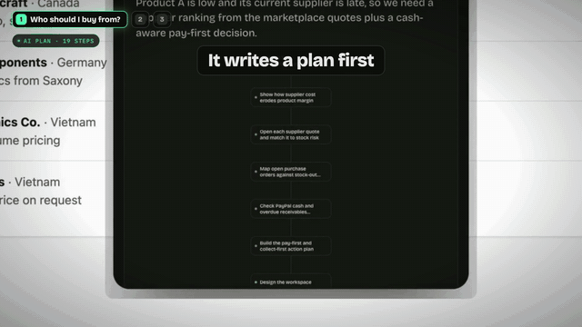 <b>Reads real supplier pages; asks before it orders.</b></td>
</tr>
<tr>
<td width="50%">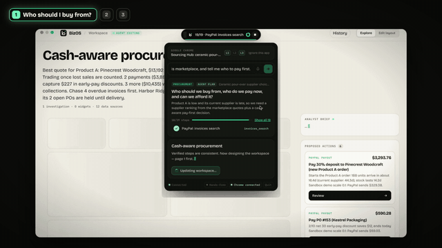 <b>The AI builds the AG Studio workspace live.</b></td>
<td width="50%"> <b>Live PayPal balance, money already leaving, a 10% cushion: pays only what fits.</b></td>
</tr>
<tr>
<td width="50%">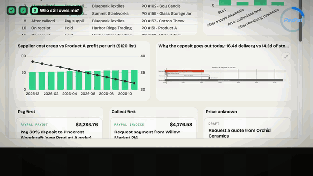 <b>Hold to approve: PayPal Invoicing + PayPal Payouts.</b></td>
<td width="50%">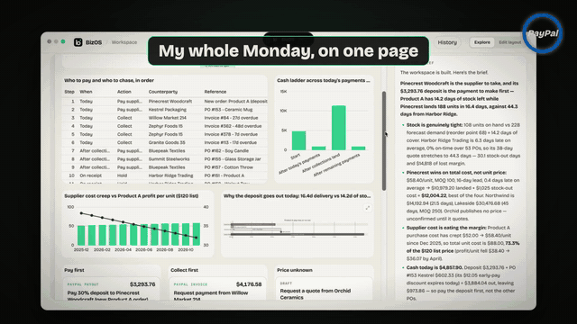 <b>Monday used to take all day. Now it takes one question.</b></td>
</tr>
</table>

## AG Studio, taken to the next level

The AI doesn't draw a chart. **It builds a whole AG Studio workspace for every question**, and BizOS **extends AG Studio itself**.

<table>
<tr>
<td width="50%">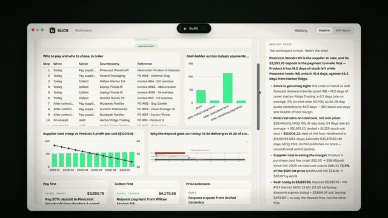 AG Grid, AG Charts, a combo chart, a gantt diagram, a live plan and PayPal approval cards, all placed by the AI.</td>
<td width="50%">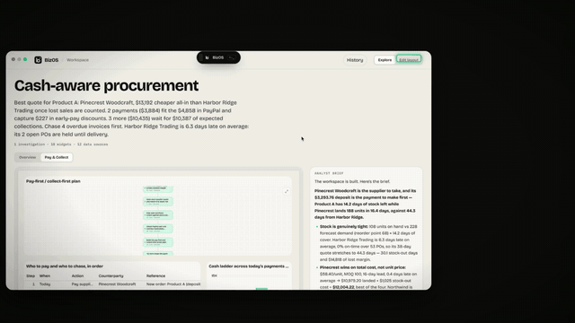 BizOS's own widgets appear in AG Studio's Compose menu, including a <b>PayPal action</b> card.</td>
</tr>
<tr>
<td width="50%"> Click an idea on the Ideas map: the dashboard asks BizOS the next question.</td>
<td width="50%"> Three questions, three different AI-designed workspaces (real runs).</td>
</tr>
</table>

- **42 widget kinds** the AI can place: AG Grid, pivot, KPI, 20 chart types, combo, scatter/bubble, treemap, sunburst, gauges, filters, text, image. It also sets the layout on a 12-column grid, names the pages, and picks a theme.
- **6 BizOS widgets registered inside AG Studio** (`createWidgets({ additionalTypes })`), each with an `ai` description for AG Studio's own AI tools:
  - Plan graph
  - Diagram
  - Ideas map
  - Summary
  - Text
  - **PayPal action**
- **17 Mermaid diagram types**, with expand, zoom and pan.
- **Live:** ask again and the **same** workspace updates in place. Your *Edit layout* changes are kept, and a version check stops the agent from overwriting newer work.

## PayPal is the money rail

  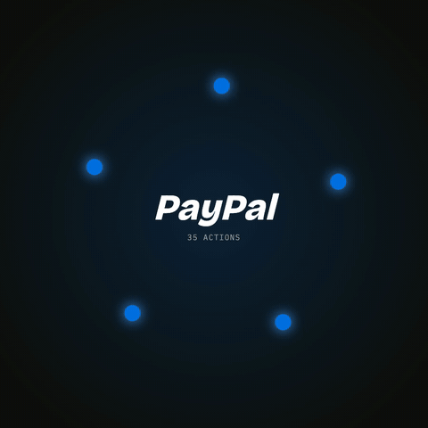

**35 approved PayPal actions, in 3 risk levels:**

- **18 Read:** BizOS does these by itself (Balances, Transaction Search, Invoices, Disputes, Orders, Refunds, Subscriptions, Payment Links, Webhooks…)
- **13 Act:** you approve a card (send / remind an invoice, payment links, orders, dispute replies…)
- **4 Money:** you **press and hold** (Payouts, Refund, Order capture, Accept dispute claim)

Card, vault and identity endpoints are **not on the list**, so no prompt can reach them.

- **Cash gate:** spendable money = PayPal balance − payouts still settling − a 10% cushion, re-checked right before each payout.
- **Sent once:** idempotency keys (`PayPal-Request-Id`, `sender_batch_id`) mean approving twice never pays twice. Every action is audited with who approved it.
- **Status flows back:** Pending, Sent and ACTIVE show on the card, and the plan graph turns green.
- **Finance too:** *"Do invoices and payments reconcile?"* matches PayPal transactions against invoices.

<table>
<tr>
<td width="50%">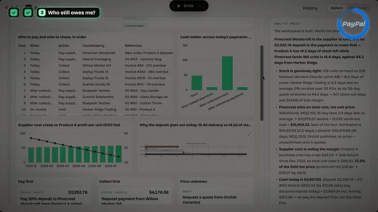 Refunds and disputes become approval cards inside the dashboard.</td>
<td width="50%"> It reads by itself. You approve. You hold for money.</td>
</tr>
</table>

## How we built it

  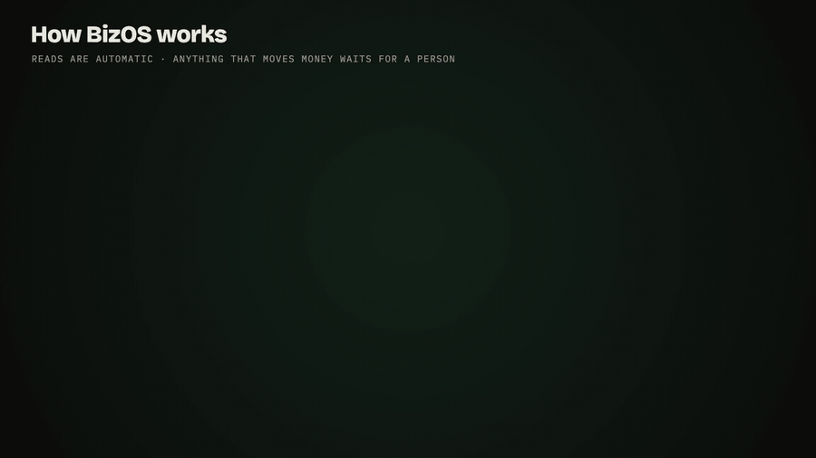

| Technology | Role |
|---|---|
| **PayPal REST APIs** (Sandbox) | Balances, Transaction Search, Invoicing, Payouts, Payment Links, Orders, Refunds, Disputes, Subscriptions, Webhooks: 35 actions, tiered, idempotent, audited |
| **AG Studio 3** (AG Grid + AG Charts) | AI-compiled workspaces, custom BizOS widgets, live in-place updates, user and AI co-editing |
| **OpenAI Agents SDK** (any OpenAI-compatible model) | Planner agent → the user sees the plan → analyst agent with tools, streamed brief |
| **Electron · React · Vite** | Floating overlay over any app, workspace window, global shortcut |
| **Chrome MV3 extension** | Reads and operates real web pages over a local bridge; risky controls always ask |
| **FastAPI · SQLite** | Backend, guarded SQL over company data, local memory of past workspaces |
| **Mermaid · React Flow** | 17 diagram types, live plan graph, Ideas map |
| **Vosk · OS dictation** | Type or talk; offline "Hey BizOS" wake word, audio never leaves the machine |
| **macOS Accessibility · Windows UI Automation** | Calendar deadlines with alarms, desktop actions with confirmations |

**Quality:** 190 backend tests and 62 desktop tests pass. The scheduling rule that decides who gets paid first is a pure, tested function.

## Challenges we ran into

- **Trusting an AI with money.** We split every PayPal endpoint into read, act and money tiers, and made press-and-hold the only path to a payout.
- **Real websites are messy.** Every supplier site has a different layout: tables, cards, prose, or "quote on request". The agent reads all of them, and says N/A instead of inventing a price.
- **Live dashboards without flicker.** Agent edits land in place in AG Studio. A version check stops an older window from erasing newer agent widgets, so the user and the AI can edit the same canvas.
- **"Cheapest" is often wrong.** Ranking by price alone picks late suppliers. We rank by **total cost**: price plus the sales lost while the shelf is empty.

## Accomplishments we're proud of

- A full loop, end to end: question → plan → real web → AI-designed AG Studio workspace → PayPal Invoicing + Payouts → calendar.
- BizOS widgets **inside AG Studio's own menu**, including a PayPal approval card.
- 35 PayPal actions behind one consistent safety model.

## What we learned

People don't want an AI that spends for them; they want one that **does the reading** and **asks at the right moment**. "Nothing moves without me" turned out to be the feature, not a limitation.

## What's next

- Go live on PayPal production with per-business spending limits.
- More flows: payroll timing, subscription churn, dispute playbooks.
- A team mode: the same workspace shared, with roles for who can approve what.
- Signed installers for Mac and Windows.

## Try it

- **Source and run guide:** [`README.md`](https://github.com/azharizz/BizOS/blob/main/README.md) · [`TECHNICAL.md`](https://github.com/azharizz/BizOS/blob/main/TECHNICAL.md)
- **Run:** `cd backend && uv sync && cd ../desktop && npm install && npm run dev`, then press **⌘⇧Space** and ask *"Which suppliers should I pay this week, and can I afford it?"*

BizOS · Ask. Check. Approve. · PayPal AI Hackathon 2026

